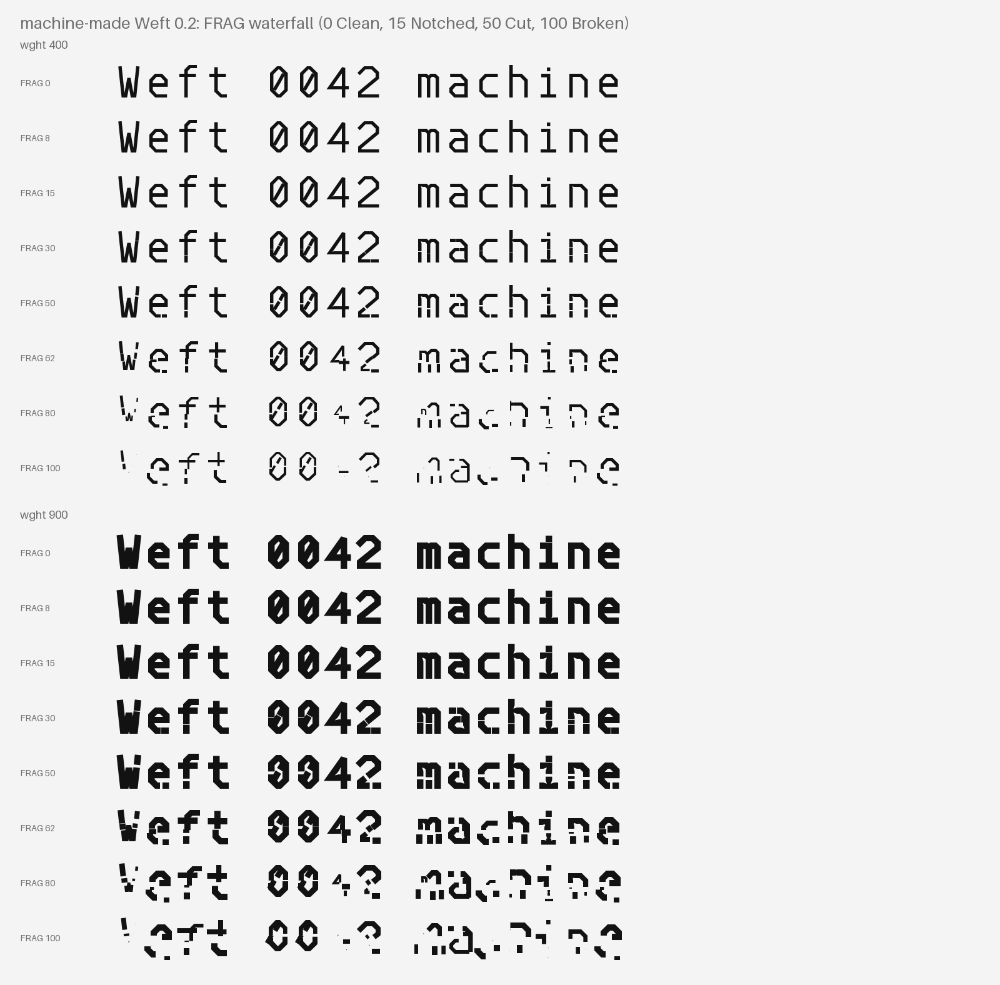
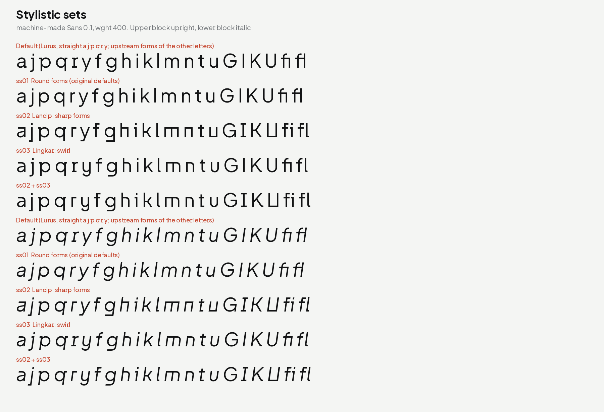
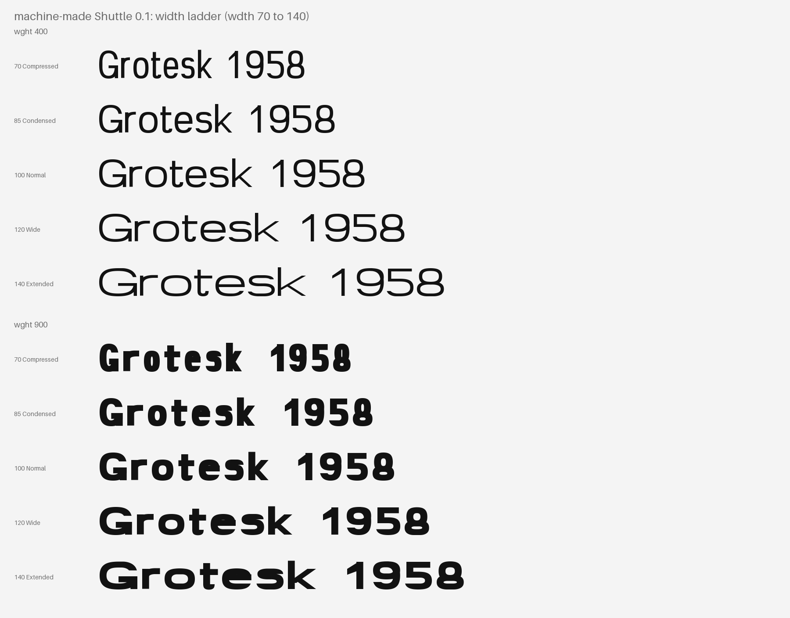

# machine-made type

Three typefaces made by code, free under the SIL Open Font License.

- **machine-made Weft**: a grid-built monospace. Variable font with a
  weight axis (`wght` 100 to 900) and a fragmentation axis (`FRAG` 0
  to 100, from clean text to broken marks). Every shape comes from a
  table of centre-line strokes.
- **machine-made Sans**: a reading sans with the same line metrics as
  Weft. Upright and italic, variable weight (`wght` 200 to 800).
  machine-made Sans is based on Plus Jakarta Sans by Gumpita Rahayu,
  Tokotype.
- **machine-made Shuttle**: a Swiss display grotesk for posters,
  headlines and big figures. Variable font with a weight axis (`wght`
  100 to 900) and a width axis (`wdth` 70 to 140, Compressed to
  Extended). Every letter is built from four parts (rect, superellipse
  ring, parallelogram, V) and level cuts.

Specimen site: <https://machine-made.github.io/type/>

## Download

| Family | Release | Contents |
| --- | --- | --- |
| machine-made Weft 0.1 | [weft-v0.1.0](https://github.com/machine-made/type/releases/tag/weft-v0.1.0) | Variable TTF, 9 static TTF and OTF, WOFF2, readability report |
| machine-made Sans 0.1 | [sans-v0.1.0](https://github.com/machine-made/type/releases/tag/sans-v0.1.0) | 2 variable TTF, 14 static TTF and OTF, WOFF2 |
| machine-made Shuttle 0.1 | [shuttle-v0.1.0](https://github.com/machine-made/type/releases/tag/shuttle-v0.1.0) | Variable TTF, 11 static TTF, WOFF2 |

The same files are in this repository in `fonts/weft/`,
`fonts/sans/` and `fonts/shuttle/`. Each release has build provenance attestations: check a
file with `gh attestation verify FILE --repo machine-made/type`.

## machine-made Weft



FRAG 0 to 15 is for body text. FRAG 16 to 50 is for headings. Above
50, pieces drift and drop out: titles and marks only. An OCR gate in CI
checks that FRAG 0 and 15 read as well as DejaVu Sans Mono
(`proofs/weft/readability.json`). Details: `weft/RELEASE-NOTES-0.1.md`.

## machine-made Sans



Straight (Lurus) forms of a, j, p, q, r, y are the defaults. Stylistic
set ss02 gives the sharp (Lancip) forms, ss01 the original Plus
Jakarta Sans forms, ss03 the swirl (Lingkar) forms. Details:
`sans/README.md` and `sans/RELEASE-NOTES-0.1.md`.

## machine-made Shuttle



Width changes the counters, not the stems. The 70 characters of the
approved sketch match the sketch engine at every corner of the
designspace (`proofs/shuttle/shuttle-sketch-vs-font-charset.png`).
Details: `shuttle/RELEASE-NOTES-0.1.md`.

## How to build

Needs Python 3.14 and, for the checks, the
[Fontspector](https://github.com/fonttools/fontspector) 1.9.0 binary.
All builds are byte-reproducible: a build on the committed sources
gives the committed fonts.

Weft (from `weft/`):

```sh
cd weft
python -m pip install -e ".[test]"
python -m pytest -q             # generator tests
scripts/build.sh                # fonts/weft/{variable,ttf,otf,webfonts}
scripts/check.sh fontspector    # Fontspector, universal profile
python tools/readability.py --gate   # OCR gate (needs tesseract-ocr, fonts-dejavu-core)
python tools/proof.py           # proofs/weft/
```

Sans (from the repository root):

```sh
python -m pip install -r sans/requirements.txt
sans/scripts/build.sh                    # fonts/sans/{variable,ttf,otf,webfonts}
sans/scripts/check.sh fontspector        # Fontspector and varLib.interpolatable
git clone https://github.com/tokotype/PlusJakartaSans /tmp/pjs
git -C /tmp/pjs checkout 18d1cd2f7ea10481919d2f05c1f7064b7307fc26
SANS_UPSTREAM=/tmp/pjs python -m pytest -q sans/tests
python sans/scripts/proof.py --upstream /tmp/pjs/fonts --weft fonts/weft/ttf/MachineMadeWeft-Regular.ttf
```

Shuttle (from `shuttle/`):

```sh
cd shuttle
python -m pip install -e ".[test]"
python -m pytest -q             # generator tests (one needs node)
scripts/build.sh                # fonts/shuttle/{variable,ttf,webfonts}
scripts/check.sh fontspector    # Fontspector, universal profile
python tools/proof.py           # proofs/shuttle/
python tools/drift.py           # proofs/shuttle/drift.json
python tools/sketch_compare.py  # sketch engine vs font (needs Playwright and Chromium)
```

Site (from the repository root):

```sh
python -m pip install -r site/requirements.txt
python site/build.py            # site/_site/
```

## Repository layout

| Path | Content |
| --- | --- |
| `weft/` | Weft generator (`loom/`), tools, tests, brief, notes, `OFL.txt` |
| `sans/` | Sans sources (fork of Plus Jakarta Sans), scripts, tests, upstream credits, notes, `OFL.txt` |
| `shuttle/` | Shuttle generator (`loom/`), tools, tests, sketch reference, brief, notes, `OFL.txt` |
| `site/` | Specimen site generator, pages and assets |
| `fonts/weft/`, `fonts/sans/`, `fonts/shuttle/` | Committed build outputs: `variable/`, `ttf/`, `otf/` (Weft, Sans), `webfonts/` |
| `proofs/weft/`, `proofs/sans/`, `proofs/shuttle/` | Proof sheets, the Weft readability report, the Shuttle sketch comparison and drift report |
| `.github/workflows/` | `weft.yml`, `sans.yml`, `shuttle.yml` (checks), `site.yml` (Pages deploy), `release.yml` (releases on tags) |

## Licence

- **Fonts**: SIL Open Font License 1.1 with the Reserved Font Name
  "machine-made". Weft: `weft/OFL.txt`. Sans: `sans/OFL.txt`, which
  also keeps the Plus Jakarta Sans copyright line. Shuttle:
  `shuttle/OFL.txt`.
- **Code** (generators, scripts, tests, CI, site): Apache-2.0, see
  `LICENSE`.

`LICENSING.md` lists which licence covers which path.

machine-made Sans is based on Plus Jakarta Sans by Gumpita Rahayu,
Tokotype (<https://github.com/tokotype/PlusJakartaSans>).

## Made by agents

AI agents wrote the generators, the fonts, the tests, the CI and the
site. Jac, the director agent of machine-made, plans the work. People
set the goals and review the proofs. See `STATUS.md`.
