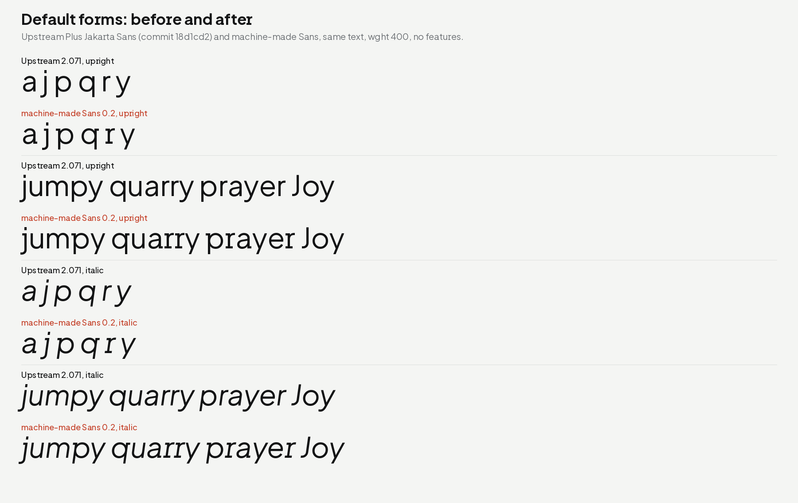

# machine-made Sans

A reading sans for machine-made. Version 0.1 is a modified version of
**Plus Jakarta Sans** with the straight (Lurus) alternates as the
default forms, the sharp (Lancip) alternates in a stylistic set, and
with line metrics that match machine-made Weft. Version 0.2 will redesign the shapes in the style of
Weft.



## Credit

**Based on Plus Jakarta Sans by Gumpita Rahayu, Tokotype.**

Plus Jakarta Sans was designed by Gumpita Rahayu (Tokotype) and was
first made for the +Jakarta City of Collaboration identity (6616 Studio,
Jakarta Provincial Government, 2020). It is released under the SIL Open
Font License 1.1 at <https://github.com/tokotype/PlusJakartaSans>.
All outlines, spacing and kerning in machine-made Sans 0.1 are from that
project. No outline comes from any other font.

The upstream credit files are in [`upstream/`](upstream/), unchanged:
`AUTHORS.txt`, `CONTRIBUTORS.txt`, `FONTLOG.txt`, `README.md` and
`OFL.txt`. The fonts carry the credit too: the copyright string (name
ID 0) has both copyright lines, the designer (name ID 9) is "Gumpita
Rahayu (Tokotype); modified by machine-made", the designer URL (name
ID 12) is tokotype.com, and the description (name ID 10) says "Based on
Plus Jakarta Sans by Gumpita Rahayu, Tokotype."

## Fork point

| Field | Value |
| --- | --- |
| Upstream | <https://github.com/tokotype/PlusJakartaSans> |
| Commit | `18d1cd2f7ea10481919d2f05c1f7064b7307fc26` (2024-01-18, "Merge pull request #39 from ravid-dubsteper/cyrillic-development") |
| Upstream version | 2.071 |
| Files forked | `sources/PlusJakartaSans.glyphs`, `sources/PlusJakartaSans-Italic.glyphs`, `sources/config.yaml` |

The first Sans commit on this branch adds the upstream files unchanged.
The next commits change them, so `git diff` against that commit shows
every change.

## Changes from Plus Jakarta Sans

All source changes are made by [`scripts/fork.py`](scripts/fork.py) from
the pinned upstream sources. The script is deterministic, and a test
checks that the committed sources are its output.

1. **Name.** Family "machine-made Sans", file and PostScript prefix
   `MachineMadeSans`, version 0.100, vendor `NONE`. The names "Plus
   Jakarta Sans" and "Jakarta" are not in any name, file name or STAT
   record. They stay only in the credit text (copyright and
   description).
2. **Default forms.** The upstream Lurus (straight, upstream ss02)
   alternates are now the default glyphs: a, j, r, y, p, q and their
   accented forms. The old default forms are not removed: they are
   `X.ss01` glyphs, in the ss01 set. All upstream Lancip (sharp,
   upstream ss01) alternates are now `X.ss02` glyphs, in the ss02 set.
   All other letters keep the upstream default form.
3. **Stylistic sets** (all with names in the font):

   | Set | Name | Content |
   | --- | --- | --- |
   | ss01 | Round forms (original defaults) | The upstream default forms of a, j, r, y, p, q and their accented forms. |
   | ss02 | Lancip: sharp forms | All sharp forms: f g h i k l m n t u G I K U, the sharp a j r y, and their accented forms. It also works after ss01. |
   | ss03 | Lingkar: swirl | Upstream Lingkar set, unchanged. It applies to the default, ss01 and ss02 forms. |
   | ss04 | Bulgarian Cyrillic | Upstream set, unchanged in effect. |

4. **Ligatures.** The f ligatures (fi, fl, ff, ffi, ffl) work as in
   upstream: f, i and l keep the round default form, so liga makes the
   ligatures in default text. The liga feature comes after the sets, so
   with ss02 on, f, i and l are sharp and no round ligature replaces
   them. The sharp f has no hook over the next letter and needs none.
5. **Composite glyphs** that use a changed letter follow the new
   default: the Cyrillic look-alikes а, р, у, ў, ј and the digraphs ij,
   Lj, Nj, lj, nj (and nj.ss02, nj.ss03). Their widths, component offsets
   and anchors change with the new base. No outline changes. Cyrillic
   п, ш, ц and the Bulgarian forms do not change, and the default Latin
   n, m, u keep their upstream form.
6. **Line metrics.** typo and hhea 906/−281/0, the same as Weft 0.1 (see
   `STATUS.md`). The win metrics stay at 1296/356.
7. **Repairs of upstream source errors** (needed to build with current
   tools):
   - The ss04 feature code had escaped quotes (`\"`) that feaLib rejects.
     The feature name is now a Glyphs feature label.
   - The unused `@noexport` class listed glyphs that do not export.
     feaLib stops on it. It is removed.
   - `upDownArrow` (U+2195) had a component with `scale = (0,0)`. With
     glyphsLib, this made the glyph empty in the static fonts. The scale
     key is removed.
   - The upright Bold instance was not marked as bold, so fsSelection
     and macStyle did not show Bold. It is now style-linked to Regular.
   - Upstream has a second, unused "Regular" instance at wght 200 in the
     upright source. It is removed.
8. **Build finish** ([`scripts/finish.py`](scripts/finish.py)): PostScript
   names without a hyphen, the WWS bit, a STAT table in each static
   font, no TrueType `prep` table in the OTF fonts.

### Default forms

The changed letters, with each accented form in the same group:

| Form | Letters | Where |
| --- | --- | --- |
| Lurus (straight) | a, j, r, y (and à á â ã ä å ā ă ą ǻ ạ ả ấ ầ ẩ ẫ ậ ắ ằ ẳ ẵ ặ ȁ ȃ, ĵ ȷ, ŕ ř ŗ ȑ ȓ ṛ ṟ, ý ÿ ŷ ẏ ỵ ỳ ỷ ỹ ȳ), p, q | Default. The old default is in ss01. |
| Lancip (sharp) | f, g, h, i, k, l, m, n, t, u, G, I, K, U (and their accented forms, ı, ħ, ŀ, ł, ŋ, ŧ, ư, Ư), and the sharp a, j, r, y | ss02. The other letters keep the upstream form as the default. |

48 glyphs per style change default form (Lurus). 175 glyphs per style
have a sharp form in ss02: 129 that have only a sharp alternate and the
46 forms of a, j, r, y that have both.

## Licence and Reserved Font Name

The fonts and sources are under the **SIL Open Font License 1.1**. See
[`OFL.txt`](OFL.txt). It has the upstream copyright line, unchanged, and
the new line:

```
Copyright 2020 The Plus Jakarta Sans Project Authors (https://github.com/tokotype/PlusJakartaSans)
Copyright 2026 The machine-made Sans Project Authors (https://github.com/machine-made/type),
with Reserved Font Name "machine-made".
```

**Reserved Font Name decision: add "machine-made".** Reasons:

- Upstream declares no Reserved Font Name, so there is no RFN to keep
  or to avoid. The family name "machine-made Sans" does not use any
  upstream name.
- The OFL FAQ (version 1.1-update7, November 2023), entry 5.10, answers
  "Can I add other Reserved Font Names when making a derivative font?"
  with "Yes. List your additional Reserved Font Names after your
  additional copyright statement, as indicated with example
  placeholders at the top of the OFL.txt file. Be sure you do not
  remove any existing RFNs but only add your own." `OFL.txt` does
  exactly this.
- The RFN is the same as for machine-made Weft (root `OFL.txt`), so one
  name protects the house name in both families.
- Effect: a person who modifies machine-made Sans and distributes it
  must use a name that does not contain "machine-made". Plus Jakarta
  Sans itself is not affected: the RFN covers only the machine-made
  contribution, and anyone can still fork the upstream project.

Source of the FAQ text: `OFL-FAQ.txt` in `silnrsi/font-andika` (commit
`0fefb76`), which is the SIL copy of the FAQ. The build machine could
not reach openfontlicense.org (the proxy blocks it), so the FAQ was read
from that copy. A person should confirm on
<https://openfontlicense.org/ofl-faq/> that entry 5.10 has not changed.

The build and check code in `sans/scripts` and `sans/tests` follows the
repository code licence (root `LICENSE`).

## Files

| Path | Content |
| --- | --- |
| `sources/MachineMadeSans.glyphs`, `sources/MachineMadeSans-Italic.glyphs` | Glyphs 3 sources (3 masters each: wght 200, 400, 800). |
| `sources/config.yaml` | gftools builder configuration. |
| `upstream/` | Upstream credit files and the fork point (`UPSTREAM.txt`). |
| `scripts/fork.py` | Makes the sources from the pinned upstream sources. |
| `scripts/glyphsfmt.py` | Reads and writes Glyphs files with the same text as Glyphs.app. |
| `scripts/build.sh` | Builds all fonts into `fonts/sans/`. |
| `scripts/finish.py` | Final name, STAT and WOFF2 steps. |
| `scripts/check.sh` | Fontspector (universal profile) and varLib.interpolatable. |
| `scripts/fs_summary.py` | Summary of the Fontspector reports. |
| `scripts/compare_builds.py` | Compares a new build with the committed fonts. |
| `scripts/proof.py` | Proof sheets into `proofs/sans/`. |
| `tests/` | pytest tests for sources and fonts. |
| `fontspector.toml` | Fontspector configuration (one override, with the reason). |
| `../fonts/sans/` | Variable fonts, static TTF and OTF, WOFF2. |
| `../proofs/sans/` | Proof sheets. |

## How to build

Needs Python 3.14, the packages in `requirements.txt`, and for the
checks the Fontspector 1.9.0 binary.

```sh
python -m pip install -r sans/requirements.txt
sans/scripts/build.sh                      # fonts/sans/*
sans/scripts/check.sh fontspector          # reports/sans/*
git clone https://github.com/tokotype/PlusJakartaSans /tmp/pjs
git -C /tmp/pjs checkout 18d1cd2f7ea10481919d2f05c1f7064b7307fc26
SANS_UPSTREAM=/tmp/pjs python -m pytest -q sans/tests
python sans/scripts/proof.py --upstream /tmp/pjs/fonts --weft fonts/weft/ttf/MachineMadeWeft-Regular.ttf
```

To make the sources again from upstream:

```sh
python sans/scripts/fork.py /tmp/pjs/sources sans/sources
```

The build is repeatable: `SOURCE_DATE_EPOCH` is fixed (2026-10-26), so
two builds with the same tool versions give the same bytes.
