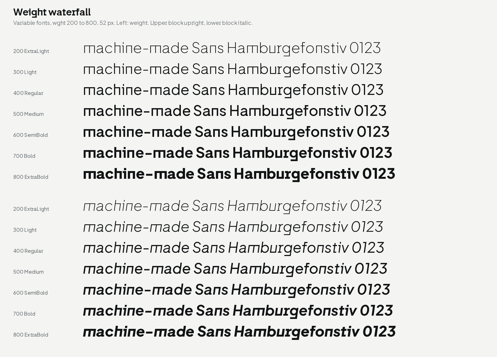

# machine-made Sans 0.1

machine-made Sans is a reading sans for machine-made. Version 0.1 is a
modified version of **Plus Jakarta Sans by Gumpita Rahayu, Tokotype**,
under the SIL Open Font License 1.1.



## What is in this release

- Two styles, upright and italic, each a variable font with a weight
  axis from 200 (ExtraLight) to 800 (ExtraBold).
- Static fonts for 7 weights per style: ExtraLight, Light, Regular,
  Medium, SemiBold, Bold, ExtraBold, as TTF and OTF (28 files).
- WOFF2 of the two variable fonts for the web.

| Folder | Files |
| --- | --- |
| `fonts/sans/variable/` | `MachineMadeSans[wght].ttf`, `MachineMadeSans-Italic[wght].ttf` |
| `fonts/sans/ttf/` | `MachineMadeSans-Regular.ttf` … `MachineMadeSans-ExtraBoldItalic.ttf` |
| `fonts/sans/otf/` | `MachineMadeSans-Regular.otf` … `MachineMadeSans-ExtraBoldItalic.otf` |
| `fonts/sans/webfonts/` | `MachineMadeSans[wght].woff2`, `MachineMadeSans-Italic[wght].woff2` |

## What is different from Plus Jakarta Sans

- **Straight and sharp forms are the defaults.** Plus Jakarta Sans has
  three sets of alternates: Lancip (sharp), Lurus (straight) and Lingkar
  (swirl). In machine-made Sans the Lurus and Lancip forms are the
  default letters. Where a letter has both (a, j, r, y), the straight
  form is the default.
- **The round forms are still there.** Turn on stylistic set 1 (ss01,
  "Round forms (original defaults)") to get the Plus Jakarta Sans
  letters. ss02 gives the sharp a, j, r, y. ss03 is the Lingkar (swirl)
  set.
- **Line metrics match machine-made Weft.** Both fonts have ascender
  875, descender −281 and line gap 0 at 1000 units per em, so they sit
  on one line with the same line height (1.156 em).
- **The f ligatures** apply only with the round forms (ss01).

CSS:

```css
@font-face {
  font-family: "machine-made Sans";
  src: url("MachineMadeSans[wght].woff2") format("woff2");
  font-weight: 200 800;
  font-style: normal;
}
@font-face {
  font-family: "machine-made Sans";
  src: url("MachineMadeSans-Italic[wght].woff2") format("woff2");
  font-weight: 200 800;
  font-style: italic;
}
body { font-family: "machine-made Sans", sans-serif; line-height: 1.5; }
.round { font-feature-settings: "ss01"; }   /* Plus Jakarta Sans forms */
```

## Known limits

- Accented capitals (Á, Ấ) are taller than the line box. With line
  height "normal", lines of accented capitals can touch. Use a line
  height of 1.3 or more.
- The italic has no Cyrillic (as upstream).
- In the italic variable font, three style names with the family name
  are longer than 32 characters, which some versions of Microsoft Word
  do not like. The static fonts do not have this problem.

## Checks

Fontspector 1.9.0, universal profile: no FAIL and no ERROR on the
variable, TTF, OTF and WOFF2 files. fontTools varLib.interpolatable: no
problems. The remaining warnings and their reasons are in
`sans/STATUS.md`.

## Licence and credit

SIL Open Font License 1.1, see `sans/OFL.txt`.

Copyright 2020 The Plus Jakarta Sans Project Authors
(https://github.com/tokotype/PlusJakartaSans).
Copyright 2026 The machine-made Sans Project Authors
(https://github.com/machine-made/type), with Reserved Font Name
"machine-made".

Plus Jakarta Sans was designed by Gumpita Rahayu (Tokotype). Thank you
for releasing it under the OFL.
