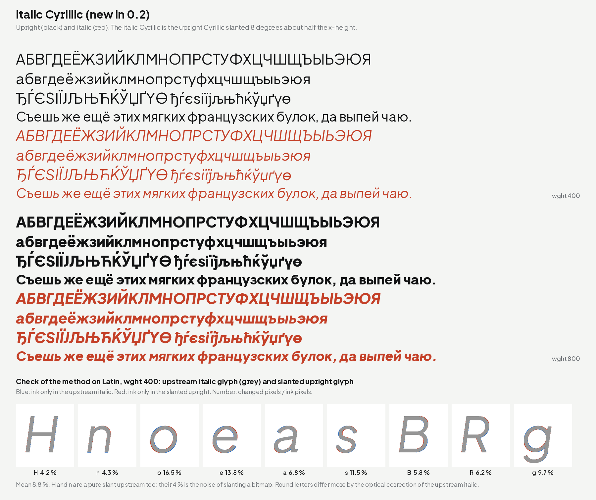

# machine-made Sans 0.2

machine-made Sans is a reading sans for machine-made. It is a modified
version of **Plus Jakarta Sans by Gumpita Rahayu, Tokotype**, under the
SIL Open Font License 1.1.

## What is new

- **Italic Cyrillic.** The italic now has the same 98 Cyrillic letters
  as the upright (Russian, Ukrainian, Belarusian, Serbian, Macedonian,
  Bulgarian with the Bulgarian forms). They are the upright letters
  slanted by 8 degrees, the same way Plus Jakarta Sans makes its Latin
  italic. The italic is a sloped roman, so и п т keep their upright
  forms.
- **Hinted OTF.** The static OTF files are hinted with otfautohint. The
  static TTF files stay hinted with ttfautohint. The variable fonts are
  not hinted.
- **Latin Extended-A is complete.** New: ſ (long s) and ʼn. Polish,
  Czech, Slovak, Hungarian, Romanian (Șș Țț), Turkish, Croatian,
  Slovenian, Latvian, Lithuanian and Estonian are covered.
- **Kerning.** Pairs such as Tì, Fî, Ľ followed by T V W Y no longer
  touch. Cyrillic letters that look like Latin letters (А, Т, о, р …)
  now kern like them.
- **Style names.** Three italic styles of the variable font have
  shorter names (XLight Italic, SemiBd Italic, XBold Italic), so they
  work in Microsoft Word. Weight menus that read the STAT table still
  show ExtraLight, SemiBold and ExtraBold.

Nothing else changed: advance widths, the word space, line metrics and
all Latin outlines are the same as in 0.1. Text set in 0.1 reflows the
same, except in the few kerning pairs above.

| Folder | Files |
| --- | --- |
| `fonts/sans/variable/` | `MachineMadeSans[wght].ttf`, `MachineMadeSans-Italic[wght].ttf` |
| `fonts/sans/ttf/` | `MachineMadeSans-Regular.ttf` … `MachineMadeSans-ExtraBoldItalic.ttf` |
| `fonts/sans/otf/` | `MachineMadeSans-Regular.otf` … `MachineMadeSans-ExtraBoldItalic.otf` |
| `fonts/sans/webfonts/` | `MachineMadeSans[wght].woff2`, `MachineMadeSans-Italic[wght].woff2` |

## With machine-made Weft

Sans and Weft share the line metrics. To match Weft's nominal x-height,
add `size-adjust: 93.3%` to the Sans `@font-face`. Most text does not
need it: the visible tops of the letters are already close.

## Known limits

- Accented capitals (Á, Ấ) are taller than the line box. Use a line
  height of 1.3 or more for text with many of them.
- The italic Cyrillic is new. Round letters such as б в з э ю я do not
  have the small optical correction that the Latin italic has.
- The word space is narrow (170 units). On the web, add a little
  `word-spacing` (machine-made.github.io uses 0.05em).

## Checks

Fontspector 1.9.0, universal profile: no FAIL and no ERROR on the
variable, TTF, OTF and WOFF2 files. fontTools varLib.interpolatable: no
problems. 249 tests pass. The OCR readability (Tesseract) is the same
as in 0.1. Two builds give the same bytes. The warnings and their
reasons are in `sans/STATUS.md`.

## Licence and credit

SIL Open Font License 1.1, see `sans/OFL.txt`.

Copyright 2020 The Plus Jakarta Sans Project Authors
(https://github.com/tokotype/PlusJakartaSans).
Copyright 2026 The machine-made Sans Project Authors
(https://github.com/machine-made/type), with Reserved Font Name
"machine-made".

Plus Jakarta Sans was designed by Gumpita Rahayu (Tokotype). Thank you
for releasing it under the OFL.
